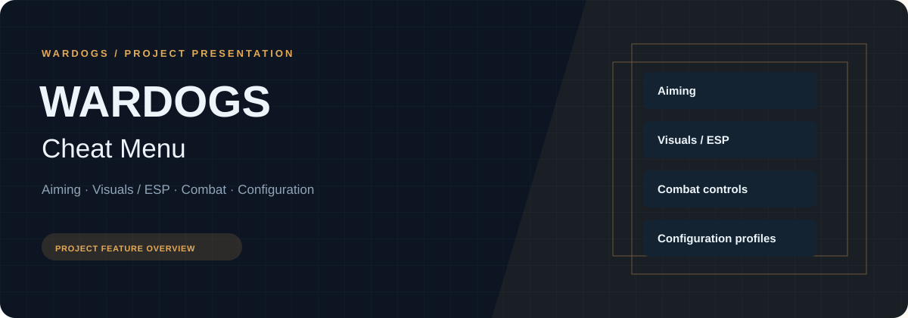
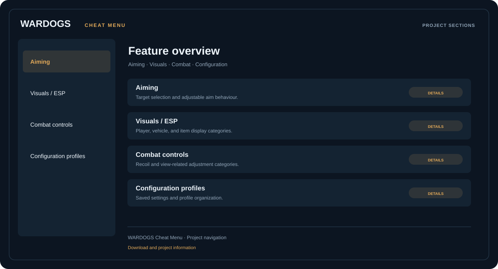

# 🎮 WARDOGS Cheat Menu

**Aiming · Visuals / ESP · Combat controls · Configuration profiles**

## ⚡ Features

WARDOGS Cheat Menu brings target-selection and aim controls, player and world ESP, combat adjustments, and configuration profiles into a single menu.

### ⚙️ Aiming

Target selection, field-of-view settings, smoothing, visibility checks, and activation-key settings.

### 🧩 Visuals / ESP

Player outlines and skeletal display categories; health, name, distance, vehicle, and item information.

### ⌨️ Combat controls

Recoil, weapon-sway, view, and crosshair settings.

### 🗂️ Configuration profiles

Save, restore, and organize configuration settings.

## 🖥️ Project navigation

## 📥 Download

The button and cover open the project's download page. Use the information supplied with the downloaded package for installation and release-specific requirements.

## 📚 Project documentation

- [Feature reference](docs/FEATURES.md)
- [Download information](docs/DOWNLOAD.md)
- [Project page](index.html)

---

WARDOGS Cheat Menu · Program documentation and download information.
